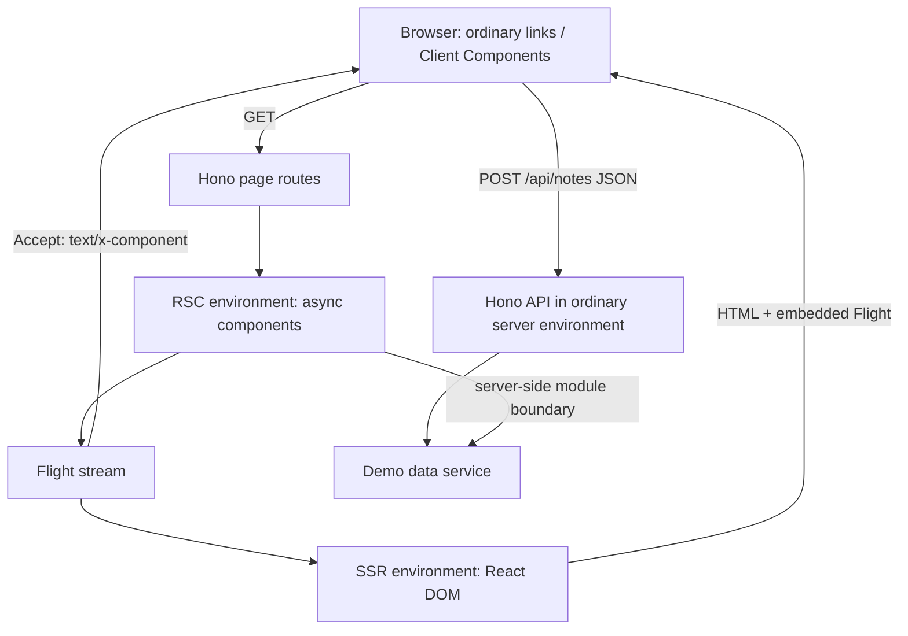

# Reference RSC — 設計とプロトタイプ

2026-10-12。名称は仮称。

## 目的

React がサーバーとクライアントをまたいで担う責務を、表示に限定する。Server Components の非同期データ取得、SSR、SSG、Client Components の Hydration は提供する。更新は Client Components のイベントハンドラから通常の HTTP API を呼び出す。

これはサーバー上の更新処理をなくす設計ではない。更新の通信境界を React の Server Function RPC に委ねず、HTTP API として明示する設計である。`<form onSubmit>`、FormData、標準の fetch はそのまま使う。

## 議論との対応

参照した議論はプロジェクト内の「RSC専用フレームワーク比較」（[チャット](https://chatgpt.com/c/6acc1ec7-10bc-83e8-8dc8-1d03907daca9)）の全4往復、および同チャット添付の「そもそも HTML の <form> がそんなに好きじゃない」と関連メモ。同期フォルダ `sources/` は空であり、変更していない。

| 議論で示された意向                                | 今回の実装判断                                                        |
| ------------------------------------------------- | --------------------------------------------------------------------- |
| RSC は好むが Server Actions は不要                | `use client` 対応、`use server` を AST 検査で拒否。RPC ハンドラーなし |
| React Router / TanStack Router との結合は避けたい | どちらも依存しない                                                    |
| HTTP ルーターと二重に定義したくない               | Hono のページ登録を唯一のマッチング規則にする                         |
| Navigation API を第一選択に                       | 通常のリンクを navigate イベントで捕捉。非対応時は MPA                |
| params/query の渡し方は検討中                     | ページ props と request-local な参照を両立                            |
| Nested Routes は必須ではない                      | 通常の Shell コンポーネントで共通化                                   |
| 共通認証は必要                                    | Hono middleware に置ける構造。認証機構自体は今回未実装                |
| 既存の部品を積極的に使う                          | Hono、Vite RSC、React、rsc-html-stream に委譲                         |

Vite の採用、同期的な server context API、履歴キャッシュを入れないこと、Node.js を最初の対象とすることは、今回の試作で決めた判断である。FUNSTACK Router の既存コードはコピーしていない。ルートの一致判定をクライアントへ配布しないという要件に合わせ、Navigation API と Flight の接続部分を独自に実装した。

## 全体構成



`src/framework/` はフレームワーク側、`src/app/` はアプリケーション例。環境エントリは両者の組み立てを行う。npm に公開できる独立パッケージ化・CLI 化はまだ行っていない。

### ルートと HTTP

```tsx
app.all("/notes/:id", page(Note));
// page は GET / HEAD だけを許し、その他を 405 + Allow で拒否する。
// app.use('/private/*', requireSession) などを page より前に置ける。
```

通常の GET には HTML、明示的な `Accept: text/x-component` には Flight を返す。認証やレスポンスヘッダーの middleware は共通になる。動的描画は `Vary: Accept` と `Cache-Control: private, no-store` を既定とする。HEAD は本文・RSC 評価を省略する。API のルートは `/api/*` の下に明示する。

ページの入口の `{ url, params }` と、深い Server Component の `getRequestURL()` / `getRouteParams()` は同じリクエストを参照する。AsyncLocalStorage で並行リクエストを分離し、URL はコピー、params は凍結して返す。React の非同期コンポーネント・Suspense をまたぐ分離もテストする。

### 表示パイプライン

RSC 環境は `react-server` 条件で動作し、RSC を Flight にシリアライズする。SSR 環境は通常の React を用い、Flight を読み戻してストリーミング HTML を生成する。同じ Flight を `rsc-html-stream` で HTML に埋め込み、ブラウザの初回 Hydration に使う。初期 Hydration 用の追加 GET は発生しない。

更新 API は SSR 側の通常のサーバー環境で実行する。サンプルのメモ保存先もそこに集約し、RSC 側からは Vite のサーバー内モジュール接続を通じて読む。この接続はブラウザに公開する RPC ではない。通常はこの部分を DB や既存のデータアクセス層に置き換える。

### ブラウザの責務

1. Navigation API の navigate イベントから、同一オリジンのページ遷移を選ぶ。
2. ハッシュのみ、download、form submission、`/api`、`/assets`、`data-native` は捕捉しない。
3. URL に Flight を要求し、結果を React の transition で反映する。
4. React が新しいツリーを commit するまで handler を完了させない。
5. 新しい遷移で古い取得を abort。結果適用時にも世代を確認する。

`useLocation()` は SSR 時の URL を初期 snapshot とし、Hydration 後はブラウザの URL を購読する。アドレスバーが先に遷移先へ変わるため、処理中の旧ページと新しい URL が一時的に共存することはある。

Client Components は同じ型・位置・key なら React の reconciliation によって状態を保持する。フレームワークが全コンポーネントの状態保持を保証するわけではない。戻る・進むも Flight を再取得する。履歴単位のキャッシュは今回入れず、更新後に古いデータを再利用する問題を避ける。

リダイレクト・Flight 以外の応答は通常の document 遷移に戻す。Flight の 404 は同じルートの Not Found UI を描画する。通信失敗・描画失敗はエラー UI と通常リロード用リンクを出す。scroll/focus は Navigation API の標準動作に委ねる。

### 更新

```tsx
await fetch("/api/notes", {
  method: "POST",
  headers: { "Content-Type": "application/json" },
  body: JSON.stringify({ text }),
});
await refresh();
```

実アプリでは例のようにレスポンスの成功を確認してから refresh する。楽観更新や TanStack Query / SWR は任意。サンプル API は同一 Origin、JSON、本文サイズ、文字数を検査する。認証・永続化・分散ストレージは用意していない。

### SSG

`prerender(path, paths)` が Hono を通して一回の RSC 描画を行い、Flight stream を分岐して HTML と `.rsc` を保存する。現在の対象は `/` と `/about`。静的生成物には対象パスの一覧だけを渡す。これはパスマッチング規則ではなく、生成済みファイルの在庫である。

静的配信時は `/about` の遷移に `/about/index.rsc` を取得する。HTML と Flight は同じ描画結果から生成するため、生成中に別々の値を読む問題がない。静的ホストは `.rsc` に `text/x-component` を設定する必要がある。対象外パスと query 付き URL は通常遷移に戻す。サンプルの `/notes` と API は Pure SSG の出力に含まれない。

## Server Functions を持たない範囲

- 元ソースの module/function directive prologue を Babel で解析して拒否する。コメントや通常の文字列は許可する。
- Vite の pre transform で検査し、RSC プラグインの変換より前に失敗させる。
- フレームワークに action ID の解決、引数デコード、関数ディスパッチを実装しない。
- ページ描画は GET / HEAD のみ。API はアプリが明示した HTTP ルートのみ。

これは依存ライブラリの全コードから Server Function 関連機能を物理的に取り除く保証ではない。Vite が外部化した依存や、他プラグインが後段で生成したコード、コンパイル済み server reference はこのソース検査の対象外になりうる。プラグインは利用者が任意のサーバーコードを実行することを隔離する sandbox でもない。

GET 内で書き込みをしないことや、DB の read-only 権限はアプリ側の責任。RSC 自体の更新追従も必要。React はフレームワーク・バンドラー向け RSC API の minor 間互換性を保証していないため、依存は exact version と lockfile で固定する。

## 今回の境界と次の検討

- Node.js 24 で検証。Workers / Bun は未検証。AsyncLocalStorage と環境間モジュール接続は移植時の検討点。
- ファイルベースルーティング、Nested Routes、prefetch、部分 Flight 更新、履歴キャッシュは未実装。
- HTTP status は stream 開始前に決める。深い非同期コンポーネントから HTTP status / redirect を変更する API はない。メモ詳細の「存在しない ID」は現時点では 200 の空状態表示。
- 認証 middleware の接続構造はあるが、認証機能・セッション管理は実装していない。
- CSP nonce、タイムアウト、途中切断時の資源回収、複数ブラウザの scroll/focus 復元、配信キャッシュ・デプロイは今後の検証対象。
- 初期 API は実装の形を確かめるためのもの。公開パッケージとしての互換性は約束しない。

## 技術資料

- [Vite RSC 公式 README](https://github.com/vitejs/vite-plugin-react/tree/main/packages/plugin-rsc)：環境分離と低レイヤー API。
- [Vite RSC 公式 starter](https://github.com/vitejs/vite-plugin-react/tree/main/packages/plugin-rsc/examples/starter)：SSR と Flight 埋め込みの接続を参照。
- [React Server Components](https://react.dev/reference/rsc/server-components)：RSC とバンドラー向け API の互換性に関する説明。
- [FUNSTACK Router](https://github.com/uhyo/funstack-router)：既存チャットで比較された参考設計。今回は直接依存しない。
